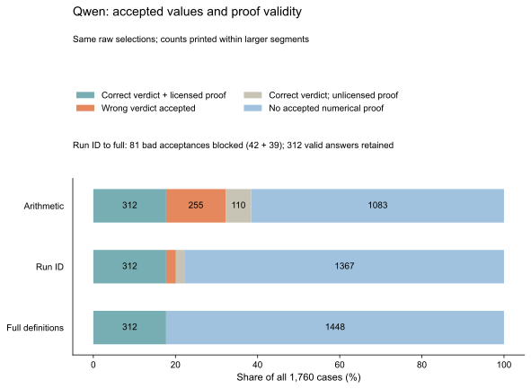

# GeoScope: checking the meaning of atomistic measurements

GeoScope studies whether language models select the right measurement and mathematical operation when interpreting atomic simulations. Two values can share the same units while describing different things: motion of an adsorbed molecule, changes in its internal shape, or displacement averaged over a larger atom set.

The project combines OC20-Dense initial structures, FAIRchem UMA relaxations, coordinate-derived evidence, and a controlled evaluation of three language models. It separates a correct comparison ID from a correct physical definition, and measures how validation changes the reliability and coverage of accepted answers.

**Status:** computational study completed and independently reviewed. Manuscript preparation remains. No paper or DOI is assigned to this project.

## Main result

Checking the comparison ID alone still permits invalid uses of a scientific number. Full-definition checking rejects additional errors involving atom selection, frame, alignment, periodic handling, weighting or the selected mathematical relation.

| Model | Full-check valid numerical answers / 1,100 answerable cases | Additional bad acceptances rejected beyond comparison-ID checking |
|---|---:|---:|
| Qwen3-4B-Instruct-2507 | 312 (28.36%) | 81 |
| Phi-4-mini-instruct | 121 (11.00%) | 245 |
| SmolLM3-3B | 168 (15.27%) | 273 |

The two checks use **identical raw model selections**. Full checking retains the same correct answers and rejects more invalid ones; it does not find replacement evidence for rejected cases. Accepted-answer coverage remains low. For Qwen, answerable-case acceptance falls from 33.82% to 28.36%.



The deterministic public-payload oracle solves **all 1,760 cases**. The full checker's perfect correctness among accepted answers follows the declared proof rules. These results support an evidence-selection diagnostic and a measured verification-versus-coverage tradeoff; they do not establish a new reasoning algorithm or 100% overall model accuracy.

Read the [final report](FINAL_REPORT.md) for exact counts, source-group intervals, failure analysis and interpretation.

## Study at a glance

- **20 development source groups** were used to develop the task and scoring protocol.
- **60 new source groups** were selected before UMA outcomes were inspected. Fifty-eight converged; **55 qualified** under the frozen geometry criteria. Two nonconverged systems and three changed molecular graphs remain in the original denominator, with no replacements.
- The final benchmark contains **880 base cases in two presentations: 1,760 variants** from the 55 qualified groups. There are 550 supported, 550 contradicted and 660 insufficient-evidence labels.
- Each model made a direct-answer request and a separate evidence/operation-selection request for every variant: **10,560 recorded first attempts** in total.
- **261 SmolLM responses reached the fixed output-token cap** and remain scored failures. There are no missing or duplicate requests. The original automated `PARTIAL_FINAL_RESULTS` status is preserved; the reviewed experiment includes all planned first attempts.

Cases cover direct measurements, unit conversion, valid subset bounds, unresolved bounds, independent anchor measurements and evidence from another comparison. Definitions and permitted mathematical relations are supplied. Scientific insufficiency and operational rejection are scored separately. All valid single-measurement proofs are accepted.

The statistical unit is the source group. The 1,760 variants are correlated examples, not independent physical experiments. See the [data card](DATA_CARD.md) for construction and applicability limits.

## Reproduce the analysis on a CPU

Python 3.12 and its standard library are sufficient. From the repository root:

```bash
python reproduce_analysis.py
```

The script verifies the preserved final evidence ZIP and its 69 member checksums, recomputes every evaluation field from raw outputs, and refuses a mismatch. It writes reports to `recomputed/`. No GPU, model download or extra Python package is required, and no archived program is executed.

The original cases, gold proofs, raw model text, settings, manifests and logs are inside [`evidence/final_results_original.zip`](evidence/final_results_original.zip). Reviewed tables and examples are in [`analysis/`](analysis/). The [reproducibility guide](docs/REPRODUCIBILITY.md) explains what can be reproduced directly and what requires the original compute artifacts.

## Three-phase workflow

| Phase | Work completed | Inspectable source |
|---|---|---|
| 1: establish the evidence | Select OC20-Dense inputs, relax with UMA, review convergence and geometry, and correct the initial case constructor. | [Initial workflow](workflows/geom_scope_phase1_uma/), [bounded continuation](workflows/phase1_continue/) |
| 2: develop the evaluation | Compare three models, separate formatting from evidence errors, and refine selection/calculation controls on the development groups. | [Pilot](workflows/phase2_pilot/), [refinement](workflows/phase2_refine/) |
| 3: freeze and evaluate new groups | Qualify a disjoint source pool, freeze cases and scoring, record every planned model attempt, then reproduce and review the final results. | [Source qualification](workflows/phase3_prepare/), [final evaluation](workflows/phase3_final/) |

The original delivery ZIPs are preserved in [`runners/`](runners/). Their extracted source is visible under `workflows/`; the original frozen workflow files have not been rewritten for this repository. Reanalysis uses the small trusted scorer in [`lib/finalstudy/`](lib/finalstudy/).

The final workflow includes **57 CPU unit tests**. Run them from the repository root without downloading models:

```bash
PYTHONPATH=workflows/phase3_final/src python -m unittest discover -s workflows/phase3_final/tests -v
```

The tests use synthetic fixtures for software verification. They are separate from the recorded model results.

## Figures and research materials

- [Figure 1: Qwen acceptance and proof validity](figures/output/01_plot1_qwen_acceptance.svg)
- [Figure 2: answerable-case coverage across models](figures/output/02_plot2_answerable_coverage.svg)
- [Figure 3: direct-answer scientific accuracy and the oracle](figures/output/03_plot3_direct_accuracy.svg)
- [Figure scripts and regeneration instructions](figures/README.md)
- [Independent audits](audits/)
- [Publication plan and accurate CV wording](PUBLICATION_AND_CV.md)

## Scope and reuse

This is a controlled same-domain evaluation of three compact instruction models. Disjoint source IDs do not establish new chemical families or independence from model training. UMA convergence and geometric consistency do not establish DFT accuracy, chemisorption, catalyst quality or a global minimum. The final groups have now been inspected; subsequent tuning on them would make them development data.

No model weights or environments are included. Original structural trajectories and development result archives remain separately hashed parent artifacts; they are required for the complete atomistic audit trail. See [sources, acknowledgments and upstream terms](THIRD_PARTY_NOTES.md). A blanket license for the project's original code has not been selected.
